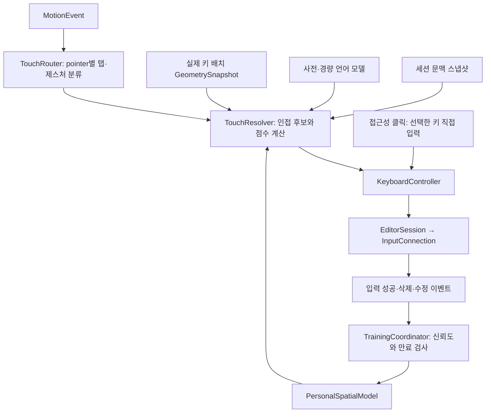

# 개인화 터치 오차 보정: 구조 분석과 구현 계획

작성일: 2026-11-05, Asia/Seoul. 현재 작업 폴더의 Kotlin 소스와 공개 연구·Android 공식 문서를 확인했다. **이 문서는 설계 제안이며, 기능 구현·정확도 실험·성능 측정을 완료한 결과가 아니다.** 아래의 임계값·일정·품질 목표는 이 앱에서 검증할 초깃값이다.

## 1. 권장 방향

**화면에 보이는 키의 위치와 크기는 유지하고, 개인별 터치 분포와 문맥에 따라 좌표를 해석하는 판정 경계를 바꾼다.** 이를 개인화 공간 모델과 문맥 모델을 결합한 확률적 키 판정으로 구현한다.

도입 순서는 `터치 처리 통합 → 개인별 위치 편향 보정 → 사전·문맥을 반영한 현재 키 보정 → 단어 후보와 선택 교정`을 권장한다. 이미 입력한 단어의 자동 치환은 별도 후속 단계다. 현재 키를 고르는 기능과 이전 입력까지 다시 해석하는 기능은 필요한 편집기 구조가 다르다.

초기 제품 범위는 한국어 두벌식·영어 QWERTY의 **문자 키 탭**이다. Delete, Enter, Shift, Space, 한영 전환, 숫자·기호, 길게 누르기, 커서·삭제 제스처는 기존 의미를 유지한다. 화면 전체를 사전 확률만으로 다시 분할하거나 키 중심을 눌렀는데 다른 글자를 내는 동작은 제한한다.

## 2. 알려진 방식과 실제 동작 원리

### 2.1 공간 모델과 언어 모델의 결합

터치가 키의 경계 부근에 있으면, 위치만으로는 의도한 키를 확신하기 어렵다. 이때 해당 위치가 각 키에서 발생할 가능성과 앞 문맥 뒤에 그 문자가 올 가능성을 결합한다. 예를 들어 영어 `q` 다음 `u/i` 경계를 누르면 문맥이 `u` 쪽 판정을 도울 수 있다. 이러한 결합 원리는 초기 확률적 키보드 연구에서 제시됐다. [Goodman 외, Language Modeling for Soft Keyboards](https://www.microsoft.com/en-us/research/publication/language-modeling-for-soft-keyboards-3/)

Gboard의 공개 연구는 키 중심에 대한 개인별 터치 오프셋을 Gaussian 공간 모델에 반영한다. 데이터가 적은 키는 인접 키를 묶어 통계를 공유하며, 기기 안에서 최근 터치의 집계 통계를 사용한다. 이 연구는 실제 제품에서 공간 개인화의 효과를 보고하지만, 그 결과가 한국어·이 앱의 개선율을 보장하지는 않는다. [Sivek·Riley, Spatial Model Personalization in Gboard](https://arxiv.org/html/2209.11311v1)

AOSP LatinIME에는 키 위치·크기, 주변 키 검색, 보정 중심과 반경을 decoder에 전달하는 구조가 있다. **참고 가능한 공개 구현이며 삼성 키보드나 현재 Gboard 내부 구현과 동일하다는 의미는 아니다.** [AOSP ProximityInfo.java](https://android.googlesource.com/platform/packages/inputmethods/LatinIME/+/refs/heads/main/java/src/com/android/inputmethod/keyboard/ProximityInfo.java)

### 2.2 이 앱에 제안하는 키 점수

```text
z = 키보드 로컬 좌표의 터치 지점
h = 현재 세션의 제한된 앞 문맥과 한글 조합 상태
p = 레이아웃·방향·폭 범주·일반/분할·언어로 구분한 프로필

S(k) = log P(z | k, p)
     + λ · log P(nextKey = k | h)
     - changePenalty(k, literalKey)

선택 키 = 허용된 인접 후보 중 S(k)가 가장 높은 키
```

여기서 `literalKey`는 학습·문맥을 적용하기 전의 기하학적 기본 키다. 버튼 안에서는 그 버튼, 문자 사이의 작은 여백에서는 같은 문자 영역의 최근접 키로 정의한다. 분할 중앙·툴바·시스템 영역·기능 키 영역에는 문자용 기본 키를 만들지 않는다. 여백의 기본 판정은 기존의 무입력 동작과 달라지므로 별도로 평가한다.

공간 모델은 각 키 중심에서 관측한 정규화 편차를 사용한다.

```text
dx = (touchX - keyCenterX) / keyWidth
dy = (touchY - keyCenterY) / keyHeight

[dx, dy] ~ Normal(personalOffset[k,p], covariance[k,p])
```

개인화 평균이 오른쪽으로 이동하면 사용자가 오른쪽으로 치우쳐 누르는 습관을 반영한다. 이웃 키와의 점수가 같아지는 지점이 판정 경계가 되므로, 실제 View 크기를 바꾸지 않아도 터치 영역이 달라진다. 키별 분산이 다를 경우 Gaussian 점수에 정규화 항도 포함한다. 큰 분산을 가진 키가 모든 영역을 차지하지 않도록 분산의 상·하한과 후보 거리 제한을 둔다.

문맥이 어느 한 키의 확률을 크게 높여도 다음 제약을 우선한다.

- 해당 문자 키와 실제 인접한 문자 키만 경쟁한다. 먼 키나 반대쪽 분할 영역으로 바꾸지 않는다.
- 키 중심의 보호 구역에서는 기본 키를 유지한다. 보호 구역 크기와 경계 이동 상한은 정규화된 키 크기로 정한다.
- 변경 후보가 기본 키보다 충분히 높고, 2위와의 점수 차이도 충분할 때만 바꾼다.
- 언어 확률에 smoothing과 영향 상한을 적용한다. 사전에 없다는 이유로 후보 확률을 0으로 만들지 않는다.
- 문맥 부재·모델 미준비·판정 시간 초과 시 공간 모델, 그것도 사용할 수 없으면 기본 판정으로 복귀한다.

따라서 동적 영역은 제한된 확률적 의사결정의 결과다. 키 사각형을 각각 확대해 겹치는 영역을 만드는 방식은 충돌 규칙이 불명확하므로 사용하지 않는다.

### 2.3 사전과 문맥 모델의 역할 구분

| 요소 | 답하는 질문 | 초기 구현안 |
|---|---|---|
| 공간 모델 | 이 사용자가 이 키를 의도했을 때 이 위치를 누를 가능성은? | 개인별 평균 오프셋, 이후 대각 공분산 |
| 단어 사전 | 현재 입력 경로로 시작하는 단어가 있는가? | 빈도 정보를 가진 trie와 접두 경로의 확률 질량 |
| 문자/자모 모델 | 앞 문자 뒤에 어떤 문자가 자연스러운가? | backoff와 smoothing이 있는 작은 n-gram |
| 단어 문맥 모델 | 앞 단어 다음에 어떤 단어가 자연스러운가? | 경량 단어 bigram, 필요 시 trigram |
| 판정 정책 | 지금 변경해도 충분히 확실한가? | 경계 제한·점수 차이·기본 후보 유지 |

사전의 존재 여부는 문맥 확률 자체가 아니다. 사전에는 빈도·접두 후보 질량이 필요하고, 문맥은 별도의 확률 모델이 담당한다. 초기에는 LLM 없이 사전과 n-gram으로 구현한다. 모델 크기와 지연을 측정한 뒤 더 큰 모델의 필요성을 판단한다.

## 3. 현재 코드에서 확인한 구조

경로는 저장소 루트 기준이며, 분석 시점의 주요 위치다.

| 현재 코드 | 확인한 동작 | 보정 도입 시 필요한 변화 |
|---|---|---|
| `app/.../ui/KeyboardView.kt:104` | 중첩 LinearLayout에 실제 Button을 배치. 키마다 3dp margin | 레이아웃 완료 후 공통 좌표계로 실제 bounds 수집 |
| `KeyboardView.kt:148` | 클릭한 버튼의 KeySpec을 controller에 바로 전달 | 좌표가 있는 탭과 접근성·프로그램 클릭 경로 구분 |
| `KeyboardView.kt:225` | 버튼별 터치, 길게 누르기, Shift, 삭제·Space 제스처 처리 | 부모에서 문자 탭을 해석하는 공통 경로 필요 |
| `KeyboardView.kt:292` | 버튼 밖 이동 시 취소, UP 때 performClick | 여백·키 경계를 넘은 유효 탭과 취소를 구분 |
| `app/.../ime/KeyboardController.kt:60` | KeySpec을 입력 명령으로 변환 | 판정 결과와 입력 출처를 받는 경로 추가 |
| `KeyboardController.kt:66` | 영문 물리 키를 Dubeolsik으로 변환해 자모 입력 | 공간 모델은 물리 키 기준, 언어 모델은 자모·문자 기준 |
| `app/.../ime/EditorSession.kt:51` | 한글의 이전 음절을 commit하고 현재 음절만 composing | 현재 키 보정은 연결 가능. 단어 전체 교정은 별도 span 관리 필요 |
| `EditorSession.kt:65` | 영어는 text마다 finishComposition 후 commitText | 영어 단어 후보를 composing으로 관리하려면 별도 변경 필요 |
| `EditorSession.kt:219` | 선택 변경·외부 편집에 따라 조합 상태 종료 | 문맥 캐시·학습 대기열·교정 후보도 함께 무효화 |
| `app/.../ime/EditorProfile.kt:21` | 비밀번호·이메일·URL·입력 종류 구분 | 학습 금지·추천 금지·자동완성·자동교정 플래그 추가 |
| `app/.../ime/MinjjImeService.kt` | 연결별 EditorSession과 회전 복구 관리 | sessionId와 문맥 revision으로 비동기 결과 검증 |
| `hangul/.../HangulComposer.kt:72` | Android와 독립된 copy() 지원 | 후보별 조합 결과를 복사본에서 미리 계산 |
| `app/.../settings/SettingsRepository.kt:53` | 명시적 UI 설정 전용 저장소 | 보정 설정만 추가하고 학습 통계 저장은 별도 분리 |

현재 사전, 언어 모델, 터치 학습기는 없다. 클립보드 저장 기능은 이미 있으나, 이를 개인화 학습 데이터로 재사용하지 않는다. README 일부 설명은 현재 소스와 차이가 있으므로 구현 계획은 실제 코드 기준이다.

**버튼의 OnTouchListener에 보정만 추가하는 것으로는 충분하지 않다.** 버튼 사이 margin에서 시작한 터치는 해당 버튼으로 전달되지 않는다. 한 버튼에서 시작한 이벤트도 자동으로 이웃 버튼에 재분배되지 않는다. 부모의 좌표 기반 판정과 pointer별 상태 관리가 핵심 선행 작업이다.

## 4. 제안 아키텍처



### 4.1 순수 Kotlin 모듈

`touch/` JVM 모듈을 추가해 좌표 계산·모델·판정·학습을 Android View에서 분리한다. 필요 시 `hangul`에 의존하고, Android 어댑터는 `app`에 둔다.

| 구성요소 | 책임 |
|---|---|
| `KeyGeometry`, `GeometrySnapshot` | 물리 키 ID, bounds, 행·분할 위치, 이웃, layoutVersion |
| `TapObservation` | DOWN/UP 로컬 좌표, pointerId, 시간, layoutVersion, 기본 키, 입력 출처. 세션 메모리 전용 |
| `TouchRouter` | 탭·길게 누르기·기능 키·취소의 단일 소유권. Android 어댑터 |
| `TouchResolver` | 기본 키·보정 키·후보 점수·판정 사유 반환. 디스크·IPC 접근 금지 |
| `SpatialModel` | 기본 분포와 개인화 평균. 후속으로 분산 추정 |
| `ContextModel`, `Lexicon` | 다음 키 확률과 backoff. 미등록어 경로 보존 |
| `ContextSnapshot` | 제한된 앞 문맥·조합 복사본·revision. 활성 세션 메모리 전용 |
| `TrainingCoordinator` | 관측의 라벨 신뢰도·보류·취소·오래된 통계 제거 |
| `SpatialStatsRepository` | 원문·순서·정밀 시간 없는 집계 통계의 비동기 저장 |
| `CorrectionPolicy` | 필드 종류, 사용자 설정, 접근성, 변경 임계값 적용 |

입력 출처는 `TOUCH_TAP / ACCESSIBILITY / LONG_PRESS / GESTURE / PASTE / PROGRAMMATIC` 등으로 명시한다. 좌표가 없는 입력에는 가짜 좌표를 만들지 않는다.

### 4.2 터치와 기존 조작의 공존

문자 탭은 부모 router가 처음부터 소유한다. 기능 키 경로도 같은 router에서 pointer별로 분리하고, 기존의 Space·Delete·Shift 상태 처리를 어댑터로 이동한다. 중간에 intercept하며 child와 parent가 같은 탭을 각각 확정하는 구조는 피한다. 실제 Button과 접근성 노드는 유지한다.

1. 레이아웃 후 각 버튼의 bounds를 KeyboardView 로컬 좌표로 변환한다. rawX/rawY를 버튼 좌표와 혼용하지 않는다.
2. DOWN에서 pointerId별로 기본 키, 좌표, geometry/model 스냅샷을 기록한다. 눌림 피드백을 표시하되 아직 문자를 넣지 않는다.
3. MOVE에서 탭 slop, 길게 누르기, 취소를 판정한다. 분할 중앙·기능 키를 가로질러 글자로 바꾸지 않는다.
4. 초기 공간 관측은 DOWN 좌표를 사용하고 UP은 탭 유효성 확인에 사용한다. DOWN/UP/평균 중 어떤 방식이 나은지는 고정 자료로 비교한다.
5. UP에서 현재까지 확정된 문맥을 읽어 한 번 판정하고 한 번만 입력한다. 문맥은 입력 이벤트가 처리된 순서로 갱신한다.
6. 길게 누르기가 발동하면 그 pointer의 일반 문자 보정을 취소하고 기존 보조 문자 동작을 실행한다. 길게 누르기의 대상은 DOWN에서 정한 기본 키로 고정한다.
7. Shift를 누른 채 다른 손가락으로 문자를 입력하는 기존 의미와 one-shot Shift 소비 규칙을 보존한다. 물리 키 ID와 Shift에 따른 출력 값은 분리한다.
8. resize·실제 geometry 변경·언어/기호 전환·detach·세션 종료에서 대기 pointer와 타이머를 취소한다. Shift 라벨 변경만으로 진행 중 chord를 취소하지 않는다.
9. TalkBack 탐색·더블 탭·외부 performClick은 사용자가 선택한 버튼을 직접 입력하며 보정·터치 학습을 건너뛴다.

geometry는 배치 때만 다시 계산하고, 개인화 모델 갱신 때문에 View를 rebuild하지 않는다. 모델은 불변 스냅샷으로 교체해 진행 중 터치가 서로 다른 통계를 섞지 않게 한다. 시각 피드백이 최종 판정과 달라진 경우 최종 선택 키를 짧게 표시하되, 비밀번호에서는 문자 노출을 추가하지 않는다.

## 5. 한국어 처리에서 필요한 설계

**완성형 음절 한 글자와 물리 키 한 번을 일대일로 대응시키면 안 된다.** `과`의 복합 모음, `값`의 겹받침, `간 → 가나`의 받침 이동에는 여러 입력과 상태 전이가 관여한다. 현재 엔진은 쌍자음을 Shift로 입력하고, 조합 중 삭제는 입력 이력을 되돌린다. 이 정책을 유지한다.

현재 키 보정은 각 인접 물리 키를 Dubeolsik으로 변환한 뒤 `HangulComposer.copy().input()`에 적용해 결과를 미리 계산한다. 실제 조합기는 선택이 끝난 뒤 한 번만 변경한다. `committed + composing` 전체와 세션 prefix를 함께 보아야 한다.

한글 언어 모델의 첫 버전은 작은 자모/음절 n-gram과 어절 접두 사전을 병행한다. 학습 자료와 실시간 입력이 사용하는 자모 표현을 통일한다. Unicode 음절 분해 결과만으로 두벌식 실제 입력 경로를 만들 수 없으므로 복합 모음·겹받침·Shift 입력을 처리하는 별도 변환기와 테스트를 둔다. 한 글자에 여러 유효 입력 경로가 있으면 그 경로를 표현하거나 문자 단위 backoff로 처리한다.

한국어는 조사·어미 결합이 많으므로 표제어 일치 여부만으로 다음 키를 제한하지 않는다. 어절 표면형 빈도와 자모/음절 backoff로 시작하고, 미등록어·이름·신조어에서 오교정이 크면 형태소 기반 점수를 후속 도입한다. `ㅋㅋ`, `ㅎㅎ`, 단독 자모, 한영 혼용도 정상 입력 후보로 남긴다. 이는 한국어 지원을 위한 이 문서의 설계 제안이다.

**단어 전체 후보는 별도 단계로 구현한다.** 현재 한글 엔진은 이전 음절을 이미 commit하고 영어도 글자마다 commit하므로, decoder 결과를 그대로 setComposingText하면 편집 범위를 잘못 대체할 수 있다.

후속 `WordCompositionSession`은 이번 입력으로 만든 어절의 literal 키 이력과 span을 추적하고, decoder 내부에서 여러 HangulComposer 상태를 beam search로 유지한다. 처음에는 터치당 치환 후보만 탐색하고 삽입·누락·전도 교정은 나중으로 미룬다. 후보 선택 시 연결·선택 위치·기존 span 내용이 모두 일치할 때만 교체한다. 이미 외부에서 바뀐 텍스트에는 후보를 적용하지 않는다. 기존 조합 이력 삭제와 후보 교체 후 삭제 의미도 먼저 정의한다.

## 6. 사용자 입력 패턴 학습

### 6.1 정답을 어떻게 얻는가

사용자의 실제 의도는 대부분 관측할 수 없다. 모델이 출력한 글자나 일정 시간 지워지지 않은 글자를 정답으로 간주해 즉시 재학습하면 오판이 강화된다.

| 관측 | 라벨 신뢰도 | 초기 정책 |
|---|---|---|
| 고정 문구를 보고 입력하는 선택형 보정 연습 | 높음. 정답과 입력 정렬 성공 시 | 교정·삭제를 정렬해 확실한 관측만 사용 |
| 키 중심의 보호 구역에서 literal과 같은 출력, 이후 국소 수정 없음 | 낮은 강도의 암묵적 신호 | 어절 경계까지 보류 후 낮은 가중치 사용 |
| 경계 보정으로 literal과 다른 출력 | 자기 예측 | 그것만으로는 학습하지 않음 |
| 삭제 뒤 다른 글자 재입력 | 의도 변경 또는 오타 가능 | 자동 정답 부여하지 않음. 한글에서는 더 엄격히 제외 |
| 후보 단어를 사용자가 명시적으로 선택 | 단어 수준 수락 | 후속 단계에서 터치-키 정렬이 명확한 관측만 사용 |
| 붙여넣기·하드웨어·접근성·길게 누르기·제스처 | 유효한 터치 정답 없음 | 공간 학습 제외 |

초기에는 기본 평균 0에서 시작한다. 키별 표본이 부족하면 같은 행·같은 분할 쪽의 집계로 backoff하고, 충분히 쌓이면 키별 평균을 상위 집계와 혼합한다. 처음부터 손가락·자세를 추정하거나 키마다 완전 공분산을 학습하지 않는다.

예시로 `effectiveN / (effectiveN + priorStrength)` 비율로 개인화 평균을 기본 평균과 섞을 수 있다. 유효 표본 30개, priorStrength 50, 중심 보호 구역 40%, 평균 이동 상한 가로·세로 각각 키 크기의 15%를 시작 실험값으로 둔다. 이 수치는 논문의 최적값이나 출시 확정값이 아니다. 강한 보정이 필요한 사용자는 명시적 연습 자료로 별도 평가한다.

### 6.2 프로필·보류·보존

- 프로필은 `layoutFamily × orientation × widthBucket × normal/split × language`로 구분한다. 크기 변화는 키 폭·높이 정규화로 흡수하고 큰 구조 변경은 별도 프로필 또는 modelVersion으로 분리한다.
- 분할의 좌/우 위치를 모델에 넣되 실제 어느 손을 썼는지 안다고 가정하지 않는다. 표본 부족 프로필은 비개인화 기본값으로 복귀한다.
- 입력 성공을 확인한 관측만 보류한다. 현재 `press()/jamo()/text()`는 성공 결과를 반환하지 않으므로 결과 이벤트 또는 성공/실패 반환 경로를 먼저 추가한다.
- 실제 InputConnection 쓰기 성공은 사용자의 수락이나 정답을 뜻하지 않는다. 정상 필드에서 어절 경계까지 검증된 중심 탭만 약한 라벨로 사용한다.
- 세션 변경·외부 선택 변경·쓰기 실패·불명확한 수정은 미반영 관측을 버린다. 반영 직후의 국소 수정을 되돌릴 수 있도록, 짧은 기간의 집계 기여분만 메모리에 보유한다. 늦게 발견한 모든 오타를 추적할 수 있다는 가정은 하지 않는다.
- 순서 없는 버킷에 `유효 가중치 합, dx/dy 합, 제곱합, 교차곱 합`만 보존한다. 저표본 버킷은 큰 그룹으로 합치고 이벤트 순서·원문·정밀 시각·pointerId를 저장하지 않는다.
- 최근 버킷만 남기는 sliding window를 사용한다. 초기 실험은 프로필당 약 800회 유효 탭 규모를 출발점으로 하고, 세부 프로필 수에 따른 데이터 부족과 보존 상한을 재평가한다. 장기 보관 기간 상한은 30일을 초기 제안으로 둔다.
- 집계 통계도 개인화 데이터다. 앱 내부의 백업 제외 저장소에 두고, 프로필 수·용량 상한과 원자적 저장·손상 시 기본값 복귀를 구현한다.

개인 단어장과 사용자의 문장 n-gram을 디스크에 저장하는 기능은 이번 범위에서 제외한다. 현재 저장소의 입력 원문 비저장 원칙과도 맞지 않는다. 기본 사전·문맥 모델은 배포용 고정 자원이고, 사용자의 최근 문맥은 메모리에만 둔다. 단어 개인화가 필요해지면 별도 보존 정책과 사용자 설정을 먼저 설계한다.

## 7. 입력창별 정책과 개인정보

Android는 `IME_FLAG_NO_PERSONALIZED_LEARNING`으로 개인화 데이터 갱신 금지를 요청할 수 있다. 이는 추천 금지 플래그와 구분된다. 이 앱에서는 공간 통계도 개인화 데이터로 취급해 갱신하지 않는다. [EditorInfo 공식 문서](https://developer.android.com/reference/android/view/inputmethod/EditorInfo#IME_FLAG_NO_PERSONALIZED_LEARNING)

`TYPE_TEXT_FLAG_NO_SUGGESTIONS`, `TYPE_TEXT_FLAG_AUTO_COMPLETE`, `TYPE_TEXT_FLAG_AUTO_CORRECT`도 프로필에 보존한다. 추천 금지·앱 자체 자동완성 필드의 사전 개입을 제한하고, 후속 단어 자동교정은 자동교정 요청 여부를 별도로 따른다. [InputType 공식 문서](https://developer.android.com/reference/android/text/InputType)

아래는 플랫폼 문서 자체의 의무 범위와 별도로 제안하는 이 앱의 초기 제품 정책이다.

| 입력 환경 | 터치 판정 | 사전·문맥 | 신규 학습 |
|---|---|---|---|
| 일반 한국어·영어 | 기본 + 선택적 개인 공간 모델 | 사용자가 켠 경우 | 개인화 설정이 켜진 경우 |
| 비밀번호·visible/web/number password | 기존 기하학 판정 | 사용 안 함, 문맥 조회 안 함 | 사용 안 함 |
| 이메일·URL | 공간 보정만 | 사용 안 함 | 초기에는 제외 |
| 숫자·전화·날짜·기호 페이지 | 기존 판정 | 사용 안 함 | 사용 안 함 |
| NO_SUGGESTIONS / AUTO_COMPLETE | 공간 보정만 | 사용 안 함 | 초기에는 제외 |
| NO_PERSONALIZED_LEARNING | 기본 공간 모델 | 허용되는 필드에서 고정 모델만 | 공간·어휘 모두 갱신 금지 |
| TYPE_NULL·입력 종류 불명 | 기존 판정 | 사용 안 함 | 사용 안 함 |
| TalkBack 선택·좌표 없는 클릭 | 선택 키 직접 실행 | 키 재해석 안 함 | 사용 안 함 |

학습 금지 필드에서 기존 개인 통계까지 사용하지 않는 것은 초기 제품의 보수적 선택이며, 해당 플래그가 기존 모델 사용까지 금지한다는 해석은 아니다.

설정에는 `터치 위치 보정`, `내 입력 위치 학습`, `문맥으로 경계 보정`, `학습 데이터 초기화`를 구분한다. 첫 베타는 실험 기능으로 꺼진 상태에서 시작하며, 학습을 켜면 어떤 집계가 남는지 짧게 설명한다. 학습 끄기는 추가 갱신 중지, 초기화는 메모리·저장 통계 제거로 의미를 나눈다. 단어 자동 치환은 후속의 별도 설정이다.

주변 텍스트는 일반 필드에서 최대 128 UTF-16 단위의 앞 문맥을 시작 한도로 두고 세션 메모리에 캐시한다. 문자 중간 절단을 정리하고 신뢰 가능한 접미부만 사용한다. 모든 터치에서 동기 IPC로 문맥을 다시 요청하지 않는다. 로컬 입력으로 갱신하고 외부 편집이 감지되면 제한적으로 재조회한다. 세션·문맥 revision이 달라진 비동기 조회/모델 결과는 버린다. 조회 실패·null은 정상적인 문맥 부재로 처리한다.

입력 원문·터치 시퀀스를 파일·로그·크래시 이벤트에 넣지 않고, 기존 INTERNET 권한 없는 구성을 유지한다. 학습 저장소는 SettingsRepository와 클립보드 저장소에서 분리한다. 초기화 직전에 시작한 저장 작업이 데이터를 되살리지 않도록 generation 검사와 저장 직렬화를 둔다.

## 8. 단계별 구현 작업과 완료 기준

1인 개발, 현재 앱 구조 유지, 데이터 자원 사용권과 기준 기기 확보를 가정한 추정이다. 일반 휴대전화·태블릿·분할 모드의 베타 검증까지 **약 6~9주**, 단어 후보·교정 후속 단계는 **추가 3~5주**를 예상한다. 모델 자원 확보나 편집기 호환성 문제로 늘어날 수 있다.

| 단계 | 예상 | 구현할 내용 | 다음 단계 진입 기준 |
|---|---|---|---|
| 0. 자료·기준선 | 3~5일 | 고정 문구와 합성 좌표 replay 형식, 보정 off 기준선, 사전·말뭉치 후보의 배포·파생 모델 사용 조건 확인 | 언어별 held-out 자료와 빌드 자원 명세. 실사용 원문 수집 없음 |
| 1. 터치 공통 경로 | 1~1.5주 | GeometrySnapshot, pointer router, 접근성 경로 분리. 모델 보정은 off | 기존 입력·길게 누르기·취소·Shift chord 회귀 통과, 여백 정책 별도 확인 |
| 2. 공간 개인화 | 1~1.5주 | 순수 Kotlin resolver, 평균 offset, 계층 backoff, 학습 보류·버킷 저장·초기화, 설정 | 중심 탭 보호·이웃 제한·학습 누출 방지·재시작 복원 통과 |
| 3. 사전·문맥 경계 보정 | 1.5~2주 | 고정 lexicon/n-gram, 두벌식 경로 변환, 후보 조합 preview, 문맥 snapshot | 한국어·영어 held-out 오타 감소, 미등록어 오교정 기준 충족 |
| 4. 통합·베타 | 1.5~3주 | release 지연 측정, 앱별 호환성, 방향·크기·분할 변경, 실사용 피드백 | 아래 품질 기준 충족. 모드별 악화가 없거나 해당 모드 비활성화 |
| 후속. 단어 후보·선택 교정 | 추가 3~5주 | WordCompositionSession, beam decoder, 후보 UI, 검증된 span 교체·되돌리기 | 단어 범위·한글 삭제·외부 편집·선택 변경 회귀 통과 |

단어 후보가 안정된 이후에만 공백 시 자동 치환을 검토한다. 자동 치환을 넣는 경우 바로 되돌리기, literal 후보 복원, 사용자 거부 후 같은 교정 반복 금지까지 함께 구현한다.

수정·추가 파일의 예상 범위:

```text
settings.gradle.kts                            :touch 모듈 등록
touch/build.gradle.kts                         순수 Kotlin JVM 구성
touch/src/main/kotlin/.../                     geometry, resolver, model, training, lexicon
touch/src/test/kotlin/.../                     확률·경계·학습·replay 검증
app/build.gradle.kts                           :touch 의존성
app/.../ui/KeyboardView.kt                      터치 공통 경로와 실제 bounds 연결
app/.../ui/TouchRouter.kt                       새 Android pointer/gesture 어댑터
app/.../ime/KeyboardController.kt               입력 출처·판정 결과 전달
app/.../ime/EditorSession.kt                    성공 결과·문맥·무효화 알림
app/.../ime/EditorProfile.kt                    입력 필드 정책용 플래그
app/.../ime/MinjjImeService.kt                  모델 수명주기·session revision
app/.../settings/SettingsRepository.kt          명시적 보정 옵션만 저장
app/.../settings/SettingsActivity.kt            옵션과 초기화
app/.../correction/SpatialStatsRepository.kt    별도 개인화 통계 저장소
app/src/main/assets/correction/                배포 조건 확인한 고정 언어 자원
app/src/main/res/values/strings.xml             설정·설명
app/src/test/, app/src/androidTest/             통합·실기기 회귀
scripts/                                      언어 자원 생성·replay 평가
docs/                                         모델 출처·측정 결과·기능 설명
```

언어 자원은 아직 확정하지 않았다. 단계 0에서 한국어·영어 각각의 출처, 라이선스와 재배포 조건, 말뭉치 분리, 정규화 규칙, 버전·checksum·빌드 재현 방법을 기록한다. 자원이 확보되기 전에도 작은 수제 fixture 사전으로 통합은 검증할 수 있으나, 그것으로 실제 언어 정확도를 통과 판정하지 않는다.

## 9. 검증 방법과 출시 판단

### 9.1 정확도 실험

동일한 정답·터치 자료에 다음 네 모드를 적용해 구성요소의 효과를 분리한다.

| 모드 | 목적 |
|---|---|
| A. 현재 버튼 판정 | 현재 제품 기준선. 여백 탭은 무입력 포함 |
| B. 새 기하학 판정 | router·여백 처리 자체의 영향 분리 |
| C. B + 개인 공간 모델 | 학습된 위치 편향의 효과 확인 |
| D. C + 사전·문맥 | 문맥 경계 보정의 추가 효과 확인 |

개인화 학습은 각 사용자의 과거 구간으로만 하고 이후 구간에서 평가한다. 언어 모델 학습 문구와 평가 문구도 분리한다. replay에는 연구용 고정 문구 또는 합성 입력만 저장하며, 사용자 평소 문장을 기록하지 않는다. 합성 오프셋 실험은 수학적 동작 확인이고 실제 정확도의 대체 자료가 아니다.

평가 항목은 물리 키 오류율, 한글 조합 후 문자 오류율(CER), 잘못 바꾼 비율, 원래 오타를 바로잡은 비율, 삭제·재입력 부담, 입력 속도다. 실사용의 수정 횟수는 의도 변경도 섞인 대리지표이며 정답 기반 오류율과 구분한다. 일반/분할·가로/세로·한영·새 사용자/충분히 학습한 사용자를 나눠 본다. 자료 수와 신뢰구간을 함께 보고한다.

초기 승인 목표는 D가 B 대비 held-out 문자 오류를 상대 10% 이상 줄이면서, 원래 정확했던 키를 잘못 바꾸는 비율을 0.1% 이하로 유지하는 것이다. C도 B와 별도로 비교한다. 이 수치는 검증 전의 제품 목표이며 소규모 평가에서 0건이었다는 사실만으로 0.1%를 입증하지 않는다. 정상 단어·이름·신조어·`ㅋㅋ/ㅎㅎ`·혼용 문구의 회귀를 따로 확인하고, 근거가 부족하면 기본 활성화를 미룬다.

### 9.2 기능·실기기 검증

- 순수 엔진: 확률 유한성, smoothing, 후보 거리·중심 보호·경계 이동 상한, 정규화 좌표, 표본 부족 backoff, 저장 손상·만료·초기화.
- 한글: 복합 모음·겹받침·받침 이동, Shift 쌍자음, 단독 자모, 이력별 backspace. 후보 preview가 실제 엔진을 변경하지 않는지 검증.
- 터치: 행간·키간 여백, 중앙 분할 gap, 키 밖 이동, ACTION_CANCEL, 길게 누르기 후 일반 탭 중복 방지, 두 손가락 문자와 Shift chord.
- 세션: 늦은 선택 콜백, 커서/선택 이동, 연결 교체, 쓰기 실패, 회전·resize 중 터치, 모델 로드 중 전환, 오래된 비동기 결과 폐기.
- 정책: 모든 password 변형, NO_PERSONALIZED_LEARNING, NO_SUGGESTIONS, AUTO_COMPLETE, TYPE_NULL에서 관측·문맥·학습 제한을 spy로 검증.
- 접근성: 기존 Button의 클릭·길게 누르기·Shift 상태와 TalkBack 탐색을 실제 기기에서 확인. 일반 탭과 접근성 클릭의 중복 없음.
- 편집기: EditText·Compose TextField·WebView와 Chrome·삼성 인터넷·카카오톡 등 지정 앱. 조회 미지원·지연·null도 포함.
- 저장: 고정 민감 fixture를 입력해도 파일·로그에 문자열·터치 순서가 남지 않음. 학습 초기화 후 비동기 저장이 통계를 복원하지 않음.

기존 테스트에서 변경한 동작과 영향을 받는 경로를 골라 확인한다. 예를 들어 새 터치 모듈의 계산만 바뀌면 `:touch:test`를 실행하고, 실제 터치 전달을 바꿨다면 iPlay60 mini Turbo에서 해당 제스처를 재검증한다. 한글 엔진, 회전 스트레스, 릴리스 검증은 해당 동작에 영향이 있거나 릴리스를 준비할 때 실행한다.

```powershell
.\scripts\build.ps1 -Tasks ':touch:test'
.\scripts\device-tests.ps1 -DeviceSerial 7ce508a5 -TestName heldShiftAndLetterUseIndependentPointers
```

### 9.3 성능과 실패 시 동작

모델 로드·학습·저장은 UI 스레드 밖에서 처리하고 resolver는 메모리 스냅샷만 사용한다. 초기 후보 상한은 터치당 최대 5개, 현재 키 보정의 새 계산 p95 2ms 이하를 목표로 한다. 사전 전체 탐색이나 디스크 읽기가 키 입력 경로에 들어가지 않게 한다.

기존 개발 계획의 IME 내부 처리 p95 10ms, 시각 피드백 p95 50ms 목표를 유지한다. release 빌드에서 기준 기기·OS·배열·모델 버전·자료를 명시하고 측정한다. InputConnection의 대상 앱 처리 지연은 순수 resolver 계산과 구분한다. 초당 15회 입력, 양손 교차 입력, 조합 중 가로·세로 전환에서 유실·중복 0건을 확인한다.

모델 미준비·조회 실패·연산 예산 초과 시 현재 탭은 기본 판정으로 처리한다. 늦게 나온 결과로 이미 입력한 글자를 사후 변경하지 않는다. 첫 베타의 off 스위치는 기존 터치 경로로 즉시 복귀할 수 있어야 한다. 성능·정확도 목표를 실제로 통과하기 전에는 기본 활성화를 하지 않는다.

## 10. 첫 구현 묶음의 명확한 범위

첫 작업은 **보정 없는 TouchRouter와 GeometrySnapshot, 입력 출처 구분, 성공 결과 전달, 기존 제스처 회귀 검증**까지다. 그 다음 개인 공간 모델과 선택형 연습을 붙이고, 사전·문맥을 추가한다. 이 순서라야 터치 처리 변화의 오류와 모델 판정의 오류를 분리해 수정할 수 있다.

현재 키의 경계 보정까지는 기존 한글 조합 정책을 유지할 수 있다. 이전 음절까지 바꾸는 후보·자동교정은 WordCompositionSession을 갖춘 다음 별도 기능으로 완성한다.
